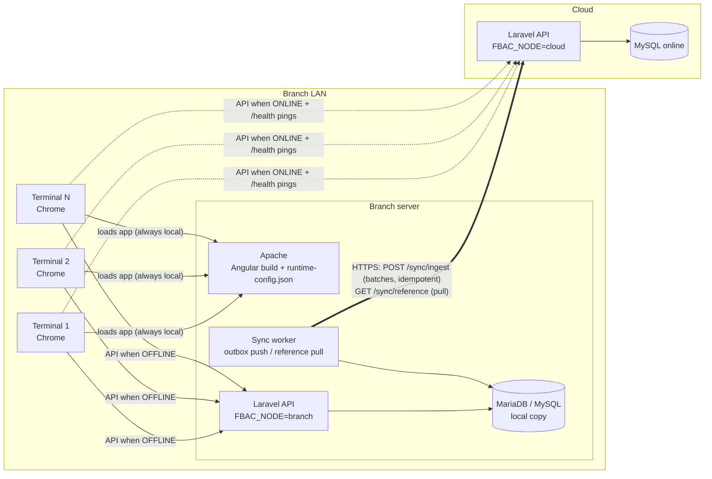

# FBAC 5.2.0 — Offline / Online Mode Architecture

Status: Phase 1 implemented. Phases 2–4 are designed below and delivered one at a time.

## Decisions taken

| Topic | Decision | Why |
|---|---|---|
| Local database | **MySQL/MariaDB on the branch server** (same major version as the cloud) | The backend has ~877 raw SQL calls, ~161 of them MySQL-specific. SQL Server would mean rewriting them and mapping types during sync. |
| Topology | **1 branch server + N terminals** on the branch LAN | Terminals share a single local DB while offline. |
| Going back online | **Configurable per branch**: `prompt` or `force` (forced switch happens only at a safe moment) | |
| Receipt / OR / invoice numbers | **Per-terminal series**, issued by the branch server | No duplicates between terminals, and it matches BIR per-machine (MIN) rules. |

## Facts from the current code that shape the design

- `_url` is a compile-time constant used in 264 files. A **runtime HTTP interceptor** rewrites the `_url` prefix, so no service needs to change (done in Phase 1).
- Tables are prefixed per branch (`{BranchId}_saleheaders`), and the backend picks the branch from the `AuthBranchId` header (`Authentication` middleware → `Session('BranchId')`).
- Detail rows reference headers by **`TransNo`**, not by the auto-increment `Id`. This makes upload order-independent once `TransNo` is unique per terminal.
- **License validation and login call `mariosoftactivator.com`.** Offline, the app could not even start. Fixed in Phase 1: on a branch node, the last good activation is cached for `FBAC_LICENSE_GRACE_DAYS` (default 7).
- `Authentication` middleware **stores `Token` but never validates it**. Any caller that sends an `AuthBranchId` header is accepted. This must be fixed before a LAN API is exposed (see Security).
- Item photos and logos are built as `_url + 'img/...'` strings in about 19 components. The interceptor cannot rewrite these (they are ``, not HttpClient calls). Fixed in Phase 2 with a small helper.

## Recommended architecture



### Decision needed before Phase 2: switching vs. local-first for POS screens

Your spec says to **switch** the whole app between the cloud API and the local API. That works, but the branch DB then lacks everything done while online. That gap breaks four things the moment the internet drops:

1. An **order opened online** (table service) is not on the branch server, so it can't be paid offline.
2. **Drawer close / X / Z reading** for a day that was half online and half offline needs data from both sides.
3. **Number continuity**: the branch must know the last OR issued online.
4. The final seconds before the drop can be lost from any "mirror down" copy.

**Recommended: local-first for POS operations.** Orders, payments, voids, the drawer and readings *always* use the branch server, which is reachable on the LAN even with no internet. The sync worker uploads continuously whenever the internet is up. Back-office screens and HQ reports keep using the cloud. Your required behaviour maps directly:

- The pop-up becomes "Internet is back → **Upload now** / **Keep holding**".
- The badge shows the same Online / Offline / Syncing / Unstable states.
- "Never lose or duplicate" gets easier, because there is only one writer per branch.

If you keep pure switching, Phases 2–4 also need: a continuous "hot data" pull (open orders, current drawer/shift, today's sales, terminal counters), a cut-over lock, and conflict handling for orders that move between sides. Phase 1 below is identical for both options.

---

## Answers to the architecture questions

### 1. Running the offline side
Confirmed: a **copy of the same Laravel backend on the branch server**, connected to local MySQL/MariaDB, with Angular switching its API base URL (`ApiTargetService` + `ApiBaseInterceptor`). Improvement: the online/offline **mode is branch-wide and stored on the branch server**, not per browser. Otherwise terminal A could write to the cloud while terminal B writes locally (split brain). Terminals read the mode from the branch server and follow it at their next safe moment.

### 2. Loading the Angular app with no internet
**Serve it from the branch server** (Apache, `http://fbac-branch/`). Terminals bookmark that URL; the cloud copy stays for HQ / back office.
- A PWA loaded from `https://cloud` cannot call `http://branch-server` on the LAN: the browser blocks mixed content and Private Network Access requests.
- The branch server must exist anyway for the local API.
- No service-worker cache going stale after deployments.
- Builds are identical. Only `assets/runtime-config.json` differs per deployment.

### 3. Real connectivity detection (Phase 2)
`ConnectivityService` pings `GET {cloud}/api/health` (no auth, `no-store`):
- Every 10 s, 4 s timeout, cache-busting query string.
- `navigator.onLine` / `online` / `offline` events are used only as hints that trigger an immediate ping.
- **Offline**: 2 consecutive failures, or any API call that fails with status 0 while targeting the cloud.
- **Stable online**: 3 consecutive successes (about 30 s) with latency < 2 s. Only then is the pop-up shown.
- **Unstable**: < 80 % success over the last 10 pings, or latency > 2 s. The badge shows Unstable, no pop-up is shown, and the user can always choose to stay offline.
- The local `/api/health` is pinged too. If the branch server is down, the badge shows a red "Branch server unreachable".

### 4. Laravel: one codebase, two databases
Each installation has **one default connection, chosen by its `.env`**:
- cloud: `FBAC_NODE=cloud`, `DB_*` → online MySQL
- branch: `FBAC_NODE=branch`, `DB_*` → local MySQL

Models, controllers and the `{BranchId}_` table logic are unchanged and never switch DB at runtime. The **branch server never gets cloud DB credentials**. It talks to the cloud only through the HTTPS sync API. A direct cross-internet MySQL connection would expose the cloud DB port to every branch and hold DB transactions open over a flaky link. Branch-only code checks `config('fbac.node')`.

### 5. Database design for sync (Phase 3)
Columns added to every **transactional** table (orders, order details, sales headers/details, payments, voids, returns, discounts, drawers/cash counts, readings, inventory movements, customers created offline), on both cloud and branch:

| Column | Purpose |
|---|---|
| `SyncId CHAR(36)` UNIQUE | UUID, the idempotency key. Set by a `BEFORE INSERT` trigger if null, so all raw `DB::` inserts are covered. |
| `TerminalId VARCHAR(10)` | Origin terminal |
| `OriginNode ENUM('cloud','branch')` | Where the row was created |
| `SyncedAt DATETIME NULL` | Branch: when verified on the cloud |

The existing auto-increment `Id` stays because the code depends on it. On the branch DB, each table's `AUTO_INCREMENT` starts in a **branch-reserved range**, so the cloud can keep the same `Id` on insert without collisions. `SyncId` remains the real dedup key.

Outbox (branch DB only). Rows are added by `AFTER INSERT/UPDATE/DELETE` triggers. These are generated by an artisan command from `INFORMATION_SCHEMA` and catch every write, including the 877 raw queries.

```sql
CREATE TABLE sync_outbox (
  Id          BIGINT UNSIGNED AUTO_INCREMENT PRIMARY KEY,
  TableName   VARCHAR(64)  NOT NULL,
  SyncId      CHAR(36)     NOT NULL,
  Operation   ENUM('upsert','delete') NOT NULL,
  Status      ENUM('pending','sending','sent','verified','failed') NOT NULL DEFAULT 'pending',
  BatchId     CHAR(36)     NULL,
  Attempts    INT          NOT NULL DEFAULT 0,
  LastError   TEXT         NULL,
  CreatedAt   DATETIME(3)  NOT NULL DEFAULT CURRENT_TIMESTAMP(3),
  SentAt      DATETIME(3)  NULL,
  INDEX ix_status (Status, Id),
  INDEX ix_row (TableName, SyncId)
);
```
The outbox stores *which row changed*. The worker reads the row's current state at send time, so ten edits to one order upload once.

### 6. Offline-safe numbering (Phase 3)
- A `terminals` table holds `TerminalId`, `BranchId`, `Code` (T01…), `MIN`, `PTU`, `ORPrefix`, `LastORNo`, `LastInvNo` and `LastTransNo`.
- The **branch server is the only issuer** of per-terminal numbers, in both modes. It is always reachable on the LAN.
- Issuing a number is a single `UPDATE terminals SET LastORNo = LAST_INSERT_ID(LastORNo + 1) WHERE TerminalId = ?` (atomic).
- `TransNo` becomes `{TerminalCode}-{seq}`, which keeps detail→header links unique across terminals.
- Safety net on the cloud: a unique index on `(TerminalId, ORNo)`. A duplicate is rejected and logged, never silently merged.
- The terminal identity is set once per PC by an admin (stored in `localStorage` and registered on the branch server) and validated on every save.

### 7. Upload sync (Phase 3)
1. The worker (`php artisan fbac:sync-push`, run by the scheduler plus on-demand) reads `pending` outbox rows in `Id` order. It skips rows younger than 5 s, so transactions still being committed aren't half-read.
2. Batches of 200. Inside a batch, rows are ordered by dependency: orders → order items → sales → payments → voids/returns → inventory movements → drawer/readings.
3. `POST {cloud}/api/sync/ingest` with `{ batchId, branchId, terminalId, items[] }`, signed with the branch API key (HMAC).
4. The cloud runs **one DB transaction per batch**: `INSERT … ON DUPLICATE KEY UPDATE` keyed on `SyncId`, then records `batchId` in `sync_ingest_log` (UNIQUE). **A repeated batchId returns the stored result without reprocessing**, so retries are always safe.
5. On ack, the branch marks the rows `sent`. If the connection drops mid-batch, the rows stay `sending` with the same `batchId` and are resent unchanged. Resume is automatic.
6. **Verification** once the queue is drained: `POST /sync/verify` with, per table and business date, `COUNT(*)`, `SUM(TotalAmount)` and `SHA2(GROUP_CONCAT(SyncId ORDER BY SyncId))`. The cloud computes the same values. On a match, rows become `verified` and `SyncedAt` is set. On a mismatch, the branch stays offline, the mismatch is shown, and the affected tables are re-sent.
7. Progress: `GET {local}/api/sync/status` → `{ state, total, done, failed }`. The Angular dialog polls it and shows "n of total".
8. Stock **balance** tables are not uploaded. Movements are uploaded and balances recomputed on the cloud, so stock received online at HQ during the outage is not overwritten.

### 8. Reference data (Phase 4)
- Cloud is master for: items, categories, prices, menu buttons, printers + PrinterItems, users, access rights, VAT/tax settings, discounts, business info, sale configs.
- A cloud-side `sync_changelog` (triggers, auto-increment cursor, captures deletes) feeds `GET /sync/reference?since={cursor}`. The branch pulls every 5 min while online, on demand, and right after each push.
- Item photos and logos are mirrored to the branch server's `public/img`.
- **While offline**, sales use the reference data the branch last received. Sale details already store item name and price, so offline sales keep their price and are never recomputed. Changes made on the cloud apply at the next pull. The badge warns if reference data is more than 24 h old.
- Reference screens are read-only in offline mode (menu items hidden or disabled). The one exception is **customers**, which can be created offline; they are synced as branch-owned rows.

### 9. Conflict rules
- **Transactional rows from the branch are never overwritten** by the cloud. The cloud API rejects edits to `OriginNode='branch'` rows while that branch has unverified outbox rows.
- **Reference data: the server wins.** The branch applies pulled rows unconditionally.
- Anything that doesn't fit these rules goes to `sync_conflicts` (both versions stored as JSON) for a supervisor to review. Nothing is dropped silently.

### 10. Edge cases
- **Offline for days**: the outbox simply grows and batching handles volume. The license works for `FBAC_LICENSE_GRACE_DAYS`. Stale reference data shows a warning. Daily Z-readings still run locally.
- **End of day / Z-reading offline**: generated on the branch from local data and uploaded as a normal transactional row with its own number. The cloud never regenerates it. *(With pure switching, a Z-reading for a mixed online/offline day must wait for sync. Local-first avoids this.)*
- **Clock differences**: transaction times and the business date (including the next-day drawer cutoff) come from the **branch server clock**, never the terminal PC. `/health` returns `serverTime`, and Angular warns if skew > 2 min. The cloud stores `ReceivedAt` separately. The branch server syncs NTP when online.
- **User switches to offline during an unstable connection**: always allowed, via the "Work offline" button on the badge. In switching mode it takes effect at the next safe moment (no open order or payment dialog).
- **Same data edited on both sides**: reference data is blocked offline (server wins). Transactions are owned by their origin side (rule 9), and conflicts are logged.

### 11. Security
1. **Fix `Authentication` middleware first**: validate `Token` + `UserId` against the login session table and return 401 otherwise. This is a cloud risk today, not only an offline one.
2. Users and password hashes are pulled to the branch as reference data, so offline login works against the branch API. The branch API issues its own session token. In switching mode the interceptor sends the matching token for each target, and going online without a cloud token asks for the password again.
3. Branch → cloud: HTTPS only, a **per-branch API key** stored in the branch `.env`, and an HMAC-SHA256 signature over `timestamp + body`. The cloud rejects requests more than 5 min old (replay protection). Keys can be revoked per branch.
4. Local API restricted to the branch network: Apache listens on the LAN interface, Windows Firewall allows only the branch subnet, MySQL `bind-address=127.0.0.1` with a least-privilege DB user, and CORS `allowed_origins` limited to the branch origin.
5. Secrets: Laravel 8 has no `env:encrypt`. Use an NTFS ACL so only the service account can read `.env`, BitLocker on the branch server disk, and no cloud DB credentials on branches at all.

### 12. Testing plan (no loss, no duplicates)
- **Unit**: interceptor rewriting; connectivity state machine with fake timers; numbering under concurrency (50 parallel requests → 50 distinct numbers); ingest idempotency (same batch twice → identical counts).
- **Trigger coverage**: write through Eloquent, `DB::table` and raw SQL, and assert each write produced an outbox row.
- **Chaos scenarios** (pull the WAN cable):
  - during order entry
  - during payment
  - during sync after batch N, then resume
  - while the browser is closed
  - branch server restarted mid-sync
- **Replay**: resend old batches; resend after the cloud already has the rows.
- **Soak**: 2 terminals offline for 3 days of scripted volume (≥ 5,000 sales including voids, discounts and VAT-exempt), then go online.
- **Reconciliation report** (pass criteria): per table per business date, branch vs cloud `COUNT`, `SUM(TotalAmount)` and SyncId checksum all equal; zero duplicate `SyncId` or `(TerminalId, ORNo)`; every outbox row `verified`.

## Phases
1. **Phase 1 (done)**: branch node config, health endpoint, offline license, runtime config + API interceptor. See [PHASE-1.md](PHASE-1.md).
2. **Phase 2**: `ConnectivityService`, go-online Material dialog (prompt / force at safe moment), image URL helper, branch-wide mode, terminal registration.
3. **Phase 3**: SyncId / outbox migrations and triggers, per-terminal numbering, `fbac:sync-push`, cloud `/sync/ingest` + `/sync/verify`, progress dialog.
4. **Phase 4**: reference pull + changelog, image mirror, conflict log, Online/Offline/Syncing/Unstable badge, sync logs screen.
